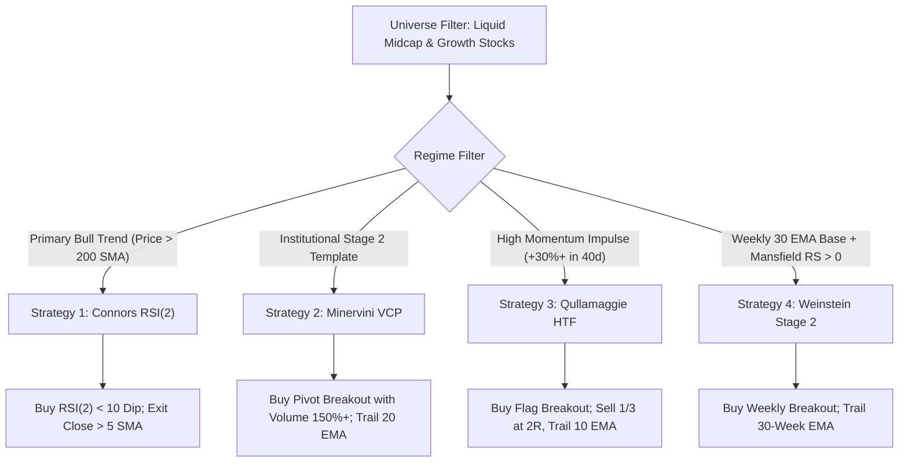

# Algorithmic Swing Trading Suite (Daily & Weekly Timeframes)

This skill provides an institutional-grade toolkit for **quantitative swing trading** across Indian Equities (NSE) and global markets. It encapsulates four historically validated technical pattern algorithms spanning **high win-rate mean reversion** and **asymmetric momentum breakout** models.

---

## The 4 Core Algorithmic Strategies

| # | Strategy Name | Core Pattern & Indicator | Primary Timeframe | Typical Hold | Target Edge | Reference Document |
| :-: | :--- | :--- | :--- | :--- | :--- | :--- |
| **1** | **Larry Connors RSI(2)** | 2-Day Panic Selloff in Primary Bull Trend ($RSI_2 < 10$, Price $> 200$ SMA) | **Daily** | 2 – 5 Days | **70%+ Win Rate**, rapid mean reversion to 5 SMA | [`references/connors_rsi2.md`](./references/connors_rsi2.md) |
| **2** | **Mark Minervini VCP** | Volatility Contraction Pattern ($T_1 > T_2 > T_3$) + 6-Point Trend Template | **Daily & Weekly** | 5 – 20 Days | Asymmetric $3.2 : 1$ R:R, institutional supply absorption | [`references/minervini_vcp.md`](./references/minervini_vcp.md) |
| **3** | **Qullamaggie High Tight Flag** | Explosive Impulse ($\ge +30\%$) followed by tight flag compression along 10/20 EMA | **Daily** | 3 – 15 Days | Large multi-bagger runners, tight $-3\%$ risk | [`references/qullamaggie_htf.md`](./references/qullamaggie_htf.md) |
| **4** | **Stan Weinstein Stage 2** | Stage 1 Base Breakout on Weekly 30 EMA + Mansfield Relative Strength $> 0$ | **Weekly** | 4 – 16 Weeks | Macro institutional markup, zero Stage 4 drawdowns | [`references/weinstein_stage2.md`](./references/weinstein_stage2.md) |

---

## Workspace Tools & Execution Scripts

All executable tools reside in the [`scripts/`](./scripts/) folder:

### 1. Unified Backtest Engine (`scripts/backtester.py`)
Run rigorous historical backtests for any individual strategy or compare all 4 strategies side-by-side on any NSE or international ticker:

```bash
# Compare ALL 4 strategies on a specific stock over the last 5 years:
python .agents/skills/swing-trading-algo/scripts/backtester.py --ticker AUROPHARMA.NS --strategy ALL --period 5y

# Backtest Connors 2-Period RSI Mean Reversion on Trent:
python .agents/skills/swing-trading-algo/scripts/backtester.py --ticker TRENT.NS --strategy CONNORS_RSI2 --period 3y

# Backtest Minervini VCP on Bharat Electronics:
python .agents/skills/swing-trading-algo/scripts/backtester.py --ticker BEL.NS --strategy MINERVINI_VCP --period 5y

# Backtest Stan Weinstein Stage 2 Weekly Breakouts against NIFTY 50:
python .agents/skills/swing-trading-algo/scripts/backtester.py --ticker HAL.NS --strategy WEINSTEIN_STAGE2 --benchmark ^NSEI --period 5y
```

**Backtester Output Metrics**:
* Total Closed Trades & Win Rate (%)
* Profit Factor & Payoff Ratio (Avg Win / Avg Loss)
* Portfolio Total Return (%) & Annualized CAGR (%)
* Maximum Drawdown (%) & Holding Period (Days)
* Estimated Sharpe Ratio

---

### 2. Multi-Strategy Live Scanner (`scripts/scanner_multi.py`)
Scans a liquid basket of equities for qualifying technical patterns and optionally pushes a formatted summary directly to your Telegram bot:

```bash
# Run multi-strategy scan on default watchlist:
python .agents/skills/swing-trading-algo/scripts/scanner_multi.py

# Run scan and dispatch formatted summary directly to Telegram:
python .agents/skills/swing-trading-algo/scripts/scanner_multi.py --telegram

# Scan a custom list of candidate stocks:
python .agents/skills/swing-trading-algo/scripts/scanner_multi.py --tickers TRENT BEL HAL DIXON MAHABANK --telegram
```

---

## Step-by-Step Trading Procedure



### Risk Management Rules (Universal)
1. **Never risk more than $1.0\% - 1.5\%$ of total portfolio equity on any single trade**.
2. **Hard Initial Stop**: Every setup must have a defined mathematical invalidation level prior to order placement:
   - Connors RSI(2): Emergency hard stop at $-5\%$ to $-7\%$.
   - Minervini VCP: Low of the final contraction wave (typically $-4\%$ to $-6\%$).
   - Qullamaggie HTF: Low of the breakout day candle (typically $-2\%$ to $-4\%$).
   - Weinstein Stage 2: Weekly close below 30-week EMA.
3. **Execution Discipline**: Never chase breakouts extended more than $5\%$ above the pivot.
